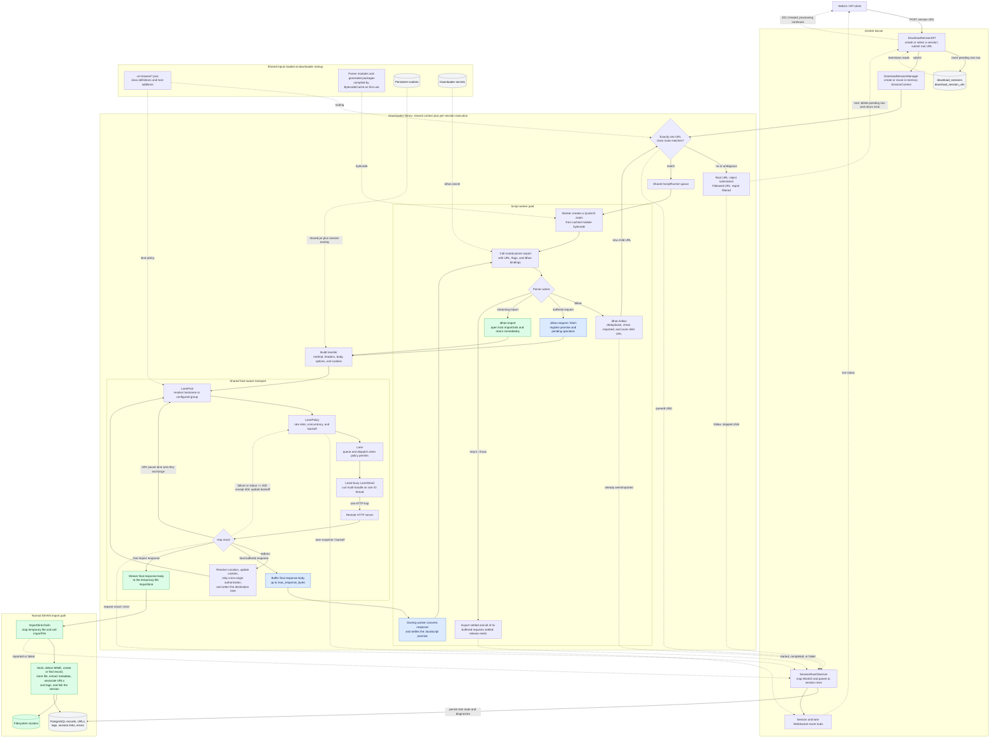

# Downloader architecture

IDHAN's downloader turns a submitted page URL into parser work, HTTP requests, discovered URLs,
and imported records. Parser logic is JavaScript, while C++ owns routing, scheduling, HTTP,
cookies, resource limits, persistence, and the handoff to the normal IDHAN import path.

This document describes the current implementation in `IDHANDownloader/` and its server adapter in
`IDHANServer/src/downloader/`. It is primarily an architecture and terminology guide; parser files
and configuration remain the executable definition of site-specific behavior.

## Mental model

The main ownership relationships are:

```text
DownloaderContext (process-wide downloader state)
├── ScriptRegistry
│   └── BytecodeCache
├── CookieStore (persistent cookies shared by every session)
├── ScriptRunner (process-wide script execution pool)
│   └── Worker(s), one QuickJS runtime each
│       └── one realm per resident work item
├── LanePool
│   ├── IoPool
│   │   └── IoThread(s), each driving many shards
│   ├── LanePolicy per lane key (rate and backoff state)
│   └── active Lane per lane key
│       └── LaneShard(s)
│           └── concurrent curl transfers and their connection cache
└── SessionContext(s)
    ├── deduplication set and work records
    ├── pending request table
    └── CookieOverlay (session cookies)
```

A typical URL takes this path:

```text
submit URL
  → match URL class and route
  → queue a work item on the shared script runner
  → a worker creates a JavaScript realm and calls the routed parser export
  → parser calls idhan.request(), idhan.follow(), or idhan.import()
  → requests enter the lane selected for their host or group
  → the lane policy grants a scheduling slot the moment it comes due
  → a shard performs one HTTP hop on an IO thread
  → redirects repeat lane selection for the new host
  → completion returns to the worker owning the realm and settles its promise
```

## End-to-end pipeline

The diagram below follows a download from the WebUI through parser execution and the shared HTTP
transport. The blue path returns a buffered response to JavaScript; the green path streams a file
into IDHAN's normal import machinery without putting its body in the QuickJS heap. Dashed arrows
show configuration, persistence, and reporting rather than ownership of the active operation.



Every redirect is a new hop through lane selection, so a cross-host redirect adopts the destination
host's cookies and rate policy. Buffered request completions return to the worker that owns the
realm; streaming imports never re-enter JavaScript and can outlive the parser work item that started
them. The session becomes idle only after both script work and all transfers, including imports,
have finished.

## Terminology

The names below refer to different scopes. In particular, a session is not a lane, a lane is not a
thread, and a shard is not a single connection.

| Term                   | Meaning                                                                                                                                                                                                          |
|------------------------|------------------------------------------------------------------------------------------------------------------------------------------------------------------------------------------------------------------|
| **Downloader context** | The process-wide owner of the parser registry, shared persistent cookie jar, and lane pool, and the factory that tracks created sessions.                                                                        |
| **Host adapter**       | Services supplied by the embedding application: import sinks and optional cookie persistence, secrets, and lane observation.                                                                                     |
| **Session**            | One logical download run: its deduplication set, session-cookie overlay, counters, and in-flight budget. A session owns no thread and no QuickJS runtime; its scripts run on the shared script runner.           |
| **Script runner**      | The process-wide pool of script threads. Each worker owns one QuickJS runtime, and a work item is bound at start to the worker whose runtime holds its realm.                                                    |
| **Root URL**           | Caller-supplied session metadata exposed by `rootUrl()`. The server adapter currently leaves it empty; submitted and followed URLs are separate work items.                                                      |
| **Work item**          | One URL selected for parser execution. It has a `WorkID` and may name the parent work item that followed it.                                                                                                     |
| **URL class**          | A merged entry from JSON fragments in the `url-classes` directory that associates hosts and route conditions with a JavaScript module and lane settings.                                                         |
| **Route**              | The matching host plus optional exact path, path prefix, and query requirements that select a parser export.                                                                                                     |
| **Parser**             | A JavaScript module. The routed export receives the URL and IDHAN bindings and may request pages, follow URLs, or import files.                                                                                  |
| **Manifest**           | Optional parser metadata used to declare flags and session cookies.                                                                                                                                              |
| **Runtime**            | The QuickJS engine owned by one script worker. All realms resident on that worker share its memory limit and microtask queue.                                                                                    |
| **Realm**              | An isolated QuickJS context for one running work item. It has its own module globals and points back to that work item's `ScriptExecution`.                                                                      |
| **Pending operation**  | A request or import whose transfer has not settled. Requests retain the originating realm; imports continue independently after it is released.                                                                  |
| **Follow**             | A parser request to submit another URL as child work. It does not perform HTTP directly.                                                                                                                         |
| **Transfer**           | One configured HTTP operation handed to the transport layer. It contains the method, URL, headers, options, cookies, and optional import sink.                                                                   |
| **Exchange**           | LanePool state retained across a redirect chain. Each redirect creates a new transfer from the same exchange.                                                                                                    |
| **Hop**                | One HTTP request/response in an exchange. Redirects are separate hops and may use different lanes.                                                                                                               |
| **Lane key**           | The scheduling identity for a host. It is normally the normalized hostname, or `group:<name>` when several hosts share a configured lane group.                                                                  |
| **Lane**               | The live queue and transport resources for one lane key. It applies concurrency and rate scheduling before assigning transfers to shards.                                                                        |
| **Lane policy**        | The durable scheduling record for a lane key: configured rate, effective interval, next slot, concurrency, and backoff. It outlives an idle lane.                                                                |
| **Shard**              | One curl multi-handle, its connection cache, and its active transfers, all attached to one downloader IO thread. A shard can hold multiple connections and transfers and can multiplex HTTP/2 or HTTP/3 traffic. |
| **IO pool**            | The downloader's epoll-based transport threads. A single IO thread can drive many shards.                                                                                                                        |
| **Import sink**        | A host-provided streaming destination for a file. Imports write into it on an IO thread instead of buffering the response in the JavaScript runtime.                                                             |
| **Cookie overlay**     | Session-local cookies. They disappear with the session and shadow shared cookies with the same name.                                                                                                             |
| **Cookie store**       | Persistent cookies shared by every session in the downloader context and optionally backed by the database.                                                                                                      |
| **Observer**           | A callback interface for session events or lane snapshots. Both may arrive concurrently: a session's work is spread across script workers, and lane callbacks come from transport threads.                       |

## Startup and shared state

`DownloaderContext::create()` performs the process-wide setup:

1. It loads JSON fragments from `url-classes` into the script registry. Files in its optional `private` subdirectory are
   loaded too. Fragments may add hosts to a class defined earlier by repeating its `name` and providing only `hosts`.
2. It loads unexpired persistent cookies through the host's `CookiePersistence`, when supplied.
3. It creates the lane pool and its IO threads.
4. It retains host adapters for imports, secrets, cookie persistence, and lane observation.

Keep reusable class behavior in a public fragment and put machine-specific hosts in
`url-classes/private/*.json`. For example, a private fragment can extend the public
`hyshare` class with `{"urlClasses":[{"name":"hyshare","hosts":["your-private-host.example"]}]}`.
The registry appends those hosts while retaining the public class's script, routes, and
lane settings. The private directory is ignored by Git and is explicitly off limits for
AI agents; add hosts there locally without sharing its contents.

Parser modules are compiled to QuickJS bytecode lazily. The first session that needs a module asks
the shared bytecode cache to compile it and its imports. Later work items deserialize that cached
bytecode into their own realms. Module imports are constrained to the configured parser directory.

### Parsers and packages

The premade parsers in `IDHANDownloader/premade/` are staged into `<build>/bin/downloader` at build
time; that directory is the parser directory both the server and the script tester default to.

An import specifier is resolved node-style: a relative one against the importing module, a bare one
against the `packages` directory inside the parser directory. Either way the result must stay inside
the parser directory. A specifier that names no file is retried with `.js`, `/index.js` and
`/src/index.js`, which is what lets a parser write `import {PostsApi} from "pawchive-api"`.

Every OpenAPI document in `IDHANDownloader/specs/` is generated into a JavaScript client under
`packages/` during the build, so a parser talks to a documented API through a typed client rather
than hand-written URL building. Generation needs `npx` and a JRE; configuration requires them when
generation is enabled. `BUILD_IDHAN_DOWNLOADER_SPECS=OFF` opts out of generation, and parsers that
import a client still need its generated package to load. `packages/superagent.js` supplies the HTTP layer the
generated clients expect on top of `idhan.request`; multipart bodies are not supported.

The context creates sessions, but a returned session borrows the registry, lanes, and cookie store.
All session handles must therefore be released before the downloader context is destroyed.

### Shared parser helpers

Import filename handling from `parser` and response validation from `validation`. Keep the import
request and URL associations explicit so readers can see exactly what a parser sends to IDHAN:

```js
import {filenameFromUrl} from "parser";
import {requestJson, z} from "validation";

const postSchema = z.object({file_url: z.string(), tags: z.array(z.string())});

export async function post(input, idhan) {
    const source = new URL(input.url);
    const data = await requestJson(idhan, postSchema, "Example post API", {
        url: new URL("/api/post.json", source).href,
        referer: source.href,
    });
    const file = new URL(data.file_url, source);
    idhan.import({
        request: {url: file.href, referer: source.href},
        filename: filenameFromUrl(file),
        urls: [
            {url: source.href, type: "post"},
            {url: file.href, type: "file"},
        ],
        tags: {[source.hostname]: data.tags},
    });
}
```

`filenameFromUrl(url)` takes a native `URL` object and extracts its final path component without
including the query or fragment. Request options, filenames, URL associations, tags, and metadata
are supplied directly to `idhan.import()` in each site parser.

`requestJson(idhan, schema, description, options)` always requests text, checks the HTTP status,
and validates the parsed JSON while retaining useful errors from the response body. Parsers that
need the final response URL or special authentication errors can use `idhan.request()` followed by
`parseJsonResponse()` directly. `validation` also exports `idSchema` for string-or-number IDs and
`recordsSchema(member, entrySchema)` for APIs returning bare arrays, wrapped singletons/arrays, or
empty results. Site-specific envelopes, authentication, and pagination stay in the site parser.

## URL classes, routes, and lane settings

The URL-class file answers two separate questions:

- **Parser routing:** which module export handles a submitted URL?
- **Transport policy:** which rate, bandwidth, concurrency, protocol, and
  group apply to a request host?

A class names a script, one or more hosts, and one or more routes. A route can require an exact
path, a path prefix, query key/value pairs, or any combination that is valid in the schema. Multiple
matching routes are reported as an error; unmatched HTTP(S) URLs use automatic file inspection.

URL comparisons use a separate key: query parameters are sorted by name, equivalent query
encodings and trailing `&` separators are normalized, and fragments are ignored. Repeated values
for the same name keep their order. Paths retain their original spelling and case. The full original
URL remains available for HTTP requests. Stored URL ordering follows `sortQueryParameters`.

URL classes accept `"sortQueryParameters": true` (the default when omitted) to sort query
parameters by name before passing URLs to storage. Set it to `false` to preserve their original
order. All public premade classes explicitly enable it. Automatic file URLs without a configured
host also use the default. Matching parser routes use their class's setting. For automatic file
inspection, an opt-out wins if multiple classes list the same host. Each associated URL and final
redirect URL resolves its own class policy. Sorting preserves every parameter, its
original encoding, repeated-name value order, and fragments, including ephemeral signatures.
HTTP requests and route matching continue to use the original URL. Comparison keys still sort
parameters even when storage sorting is disabled.

A URL class may declare `"ephemeralQuery": ["ex", "hm"]`. These case-sensitive parameter names
are omitted only from comparison keys for that class's explicitly listed hosts, including automatic
file imports on those hosts. They are retained in the URL sent to the server and stored in the
database. The public Discord class uses this declaration; its `is` parameter remains significant.
Route query conditions inspect the complete original query independently of `ephemeralQuery`.
A route may require a particular value for an ephemeral parameter; that requirement still applies.
Parameters absent from a route's `query` conditions do not constrain route matching, while parameters
absent from `ephemeralQuery` remain significant for URL comparisons.
Session follow deduplication and direct-file reuse apply the same policy. Existing URL rows are
compared using the current policy, so changing a signature or parameter order still finds prior
imports without rewriting stored URLs. Equivalent spellings mapped to different records prevent
reuse. Migration 430 adds an index to restrict database comparisons to the same resource path.

URLs are classified as direct automatically after successfully importing a single file response.
The classification uses the response MIME type and opening bytes, excluding HTML, XML, JSON,
and unknown content types. It applies to the file URL and final redirect destination, never to
associated post or source URLs. Unclaimed HTTP(S) URLs are inspected as possible files regardless
of their host or extension; explicit parser routes still take precedence.

The learned classification is stored as `urls.url_type = 'file'`. On later imports, an unambiguous direct URL
mapping to a record whose file is physically present in a verified cluster reuses the record without HTTP.
A confirmed missing file is recorded immediately and downloaded again; inaccessible storage or a
failed cluster-identity check is an error and does not mark the file missing. Tags, URL associations,
and session membership still update. Unknown, ambiguous, or no-longer-stored mappings download
normally. Concurrent first-time downloads can still overlap.

Set `forceDownload: true` on an `idhan.import` call to transfer the file again. Hosts can set
`SessionOptions::force_download` or `DownloaderConfig::force_download` for the same override;
the server exposes the latter as `downloader.force_download` (or `IDHAN_DOWNLOADER_FORCE_DOWNLOAD`).
Forcing a transfer bypasses reuse; it does not suppress response classification.

Imports also look up the incoming SHA-256 in `missing_files`. Restoring the same hash keeps its
record identity and removes it from missing-file state after storage succeeds. Deliberately deleted
records remain protected. Missing and recovered transitions call the notification stubs in
`notifications/MissingFiles.hpp`; notification delivery will be implemented later.

Lane settings begin with the downloader default of one request every five seconds, then class
settings apply, then a host object may override them. `requestRate: false` makes a host explicitly
unthrottled. `shareSubdomains` copies the configured settings to subdomains, but each hostname keeps
an independent lane, schedule, and backoff. Setting `poolSubdomains` with `shareSubdomains` pools the
base host and its subdomains into one lane policy. An explicit `lane.group` can also combine hosts,
including unrelated hosts, into one lane. When subdomain families overlap, the longest configured
suffix supplies the settings.

For example, a pooled host family can be configured as:

```json
"requestRate": {
"requests": 1,
"seconds": 5,
"shareSubdomains": true,
"poolSubdomains": true
}
```

`poolSubdomains` requires `shareSubdomains`; without pooling, inherited limits are enforced
independently for each hostname.

Routing and lane grouping are intentionally separate. An explicit matching host
and route select a parser; sharing a lane policy does not make a parser accept more URLs.

See the shipped [URL-class configuration](../IDHANDownloader/premade/url-classes/) and
[premade parsers](../IDHANDownloader/premade/) for concrete definitions.

## Sessions and work items

A session is state, not a thread. `submit()` validates the URL against the registry, then places a
work item on the script runner's single arrival-ordered queue, where any worker may pick it up.
Starting one work item, on whichever worker took it, consists of:

1. Resolving its route again.
2. Creating a QuickJS realm tied to a `ScriptExecution`.
3. Loading cached module bytecode into that realm.
4. Evaluating the module, including top-level `await`.
5. Loading manifest flags and session cookies.
6. Calling the selected export with `{url, flags}` and the `idhan` object.

The parser export may return a value or a promise. A work item completes once the export has settled
and every **request** it started has settled, because a response has to be resolved into the realm
that asked for it. Imports do not hold a work item open: nothing about an import re-enters the
realm, so a parser that fires imports and returns is finished and released immediately, while its
files keep downloading. The session stays busy until those transfers land, but no script is
resident for them.

Realms sharing a worker share that worker's QuickJS runtime and job queue. A script waiting for HTTP
is not executing JavaScript: it leaves its worker immediately, so the worker runs microtasks for its
other resident work and starts more queued work while the transfer is outstanding. One session's work
items are spread across every worker, so they also run genuinely in parallel.
The burst timeout limits one uninterrupted period of JavaScript execution, including a drain of the
worker's pending promise jobs. Time in synchronous host callbacks, including database operations during
import setup, is excluded, as is time awaiting HTTP. It is not a wall-clock timeout for an entire parser.

### Follow and deduplication

Parsers can declare a URL's database type explicitly:

```javascript
idhan.setUrlType({url: input.url, type: "gallery"});
idhan.follow({url: postUrl, type: "post"});
idhan.import({request: {url: fileUrl}, urls: [{url: postUrl, type: "post"}]});
```

The accepted values are `file`, `post`, `gallery`, and `unknown`. The server creates missing URL
and domain rows and saves the type before queuing work, including when a followed URL has already
been seen. `setUrlType` classifies without fetching or queuing the URL. Omitting a type preserves
its existing classification. Invalid declarations throw a JavaScript error, and persistence failures
reach the parser. Successful automatic file detection can subsequently update the type to `file`.
Hosts persist declarations through `SessionObserver::onUrlTypeSet`.

`idhan.follow({url})` asks the same session to create child work. Before queuing it, the session:

1. Rejects new work after cancellation.
2. Checks whether the exact URL string has already been seen in the session.
3. Gives the observer a chance to report that the URL is already imported.
4. Checks that the registry can route the URL.

The observer receives whether the URL was queued, filtered, already seen, or already imported.
Queued child work stores the caller's `WorkID` as its parent, which is how the server reconstructs
the displayed download tree. Deduplication applies to followed URLs; callers may deliberately submit
the same root URL more than once.

## Requests, lanes, policies, and shards

`idhan.request()` creates a buffered transfer. The session validates the method and headers, sets
response conversion (`text`, `json`, `bytes`, or the fetch polyfill), and attaches both cookie jars
unless credentials were omitted. It then hands the transfer to `LanePool`.

When a request must carry credentials in its query string, set `sensitiveQuery` to an array of the
query parameter names that contain them. The transfer still receives the original URL, while pending
request diagnostics, completed request events, observer callbacks, and downloader logs replace those
values with `<redacted>`.

The lane pool parses the request host and resolves its lane settings. It chooses a lane key:

- an ungrouped request uses its normalized hostname;
- a grouped request uses `group:<configured name>`.

This means all sessions share rate and concurrency enforcement for the same lane key. A fast
session cannot bypass a site's rate limit by opening another session.

### What a lane does

A lane owns the pending transfer queue for one key and tracks how many transfers it has in flight.
Before dispatching a transfer it asks its policy to claim the next scheduling slot and checks the
lane's concurrency ceiling. If the next slot is in the future, the lane arms a single wakeup for
exactly that deadline on its own IO thread rather than blocking a thread, so the head of the queue
goes out the moment the limit allows. Claiming a slot advances the schedule from the slot just
taken rather than from the observation, so a late wakeup does not push the whole cadence back.
The wakeup records the deadline and the policy generation it came from, which is what lets a nearer
deadline replace it and lets an explicit backoff reset release a parked queue at once.

The session in-flight setting is a separate control: it stops a session from starting more parser
work after enough HTTP operations are pending. It is not the per-host network ceiling. The lane's
concurrency is the limit that controls how many transfers for a host or group are dispatched at
once.

### What a shard does

A shard is the curl execution unit inside a lane. It owns:

- one curl multi-handle;
- the connections cached by that handle;
- the easy handles for active transfers;
- an attachment to exactly one downloader IO thread.

A shard is **not** one request, one connection, or one thread. One shard can run many transfers and
hold multiple connections, and curl can multiplex HTTP/2 or HTTP/3 requests over a connection.
Multiple shards may share the same IO thread, but one shard never moves between IO threads.

The first transfer creates the lane's first shard. A throttled lane remains at one shard because
its request rate is already the throughput ceiling. A busy unthrottled lane can add shards when its
queued plus in-flight load exceeds the growth threshold, up to `max_shards_per_lane`. Transfers go
to the shard with the fewest active operations.

Shards exist to let a busy, unrestricted host spread transport work and connection caches across IO
threads without weakening the lane's shared scheduling policy.

### IO threads

The IO pool uses epoll, eventfd, and timerfd. Each IO thread drives socket readiness for many curl
multi-handles and also runs posted tasks and delayed scheduling callbacks. curl handles and their
connections are created, progressed, detached, and destroyed on their owning IO thread.

When a lane has no queued or active transfers for its keep-alive window, the lane pool retires it
and closes its shards' connections. The corresponding lane policy remains, so idling cannot erase
a site's backoff.

## Redirects and per-hop policy

curl does not follow redirects internally. The lane pool handles 301, 302, 303, 307, and 308 one
hop at a time so that every destination is re-evaluated:

1. Resolve a relative `Location` against the URL that produced it.
2. Recompute the destination host's lane key and settings.
3. Reapply cookies appropriate for the destination.
4. Remove `Authorization` when crossing origins.
5. Submit the next hop through the destination lane.

For compatibility, 301, 302, and 303 change non-HEAD methods to GET and clear the request body.
307 and 308 preserve the method and body. The fetch polyfill can request manual redirect handling;
in that mode the raw hop returns to JavaScript instead.

This per-hop design is why an exchange and a transfer are different: the exchange survives the
redirect chain, while each transfer belongs to one hop and one destination lane.

## Rate limits and backoff

A lane policy converts a configured request rate into a minimum interval between scheduling slots.
For example, two requests per four seconds becomes one slot every two seconds. An unthrottled lane
has a base interval of zero.

The policy stops the lane after:

- any transfer failure other than a cancellation or a shutdown;
- HTTP 429, for the `Retry-After` the response asks for;
- other HTTP errors at or above 400, except 404.

A stopped lane dispatches nothing for `lane_error_backoff_seconds`, 30 by default and overridable
per lane with `errorBackoff`. Transfers already in flight are left to finish. Failures arriving
while the lane is stopped join the open pause rather than extending it, so a host going down does
not turn one outage into hours of backoff.

Each failure that arrives after a pause has expired widens the effective interval exponentially up
to the policy maximum, and the pause is the longer of that interval and the configured backoff. An
unthrottled lane widens from a one-second floor. Successful requests do not automatically clear it;
only an explicit reset or a policy reconfiguration restores the configured interval. Lane snapshots
expose both the configured rate and effective backed-off interval.

A 429 carrying `Retry-After` is the exception: the header sets the next slot outright, in place of
the widened interval and `lane_error_backoff_seconds`, whether it asks for longer or shorter than
they would. The only floor is the lane's configured interval, so honoring a host never pushes the
lane past its own rate. Both the delta-seconds and HTTP-date forms are accepted; an unparseable
value falls back to the widening. The pause lands before the request is retried, so every queued
request for that lane key waits behind it. A later 429 arriving inside an open pause cannot cut it
short, because the request that earned it was already in flight when the pause began.

## Buffered requests and streaming imports

`idhan.request()` and `idhan.import()` use the same lane and transport machinery but handle response
bodies differently.

### Buffered request

Without an import sink, a shard accumulates the response body in memory. `max_response_bytes`
limits this buffer. The session later converts it into the requested JavaScript representation and
settles the parser's promise.

### Streaming import

For `idhan.import()`, the host opens an `ImportSink` before the transfer starts. Response bytes are
written to the sink on the shard's IO thread, so the body does not enter the QuickJS heap and does
not consume the buffered-response limit.

Redirect response bodies are discarded, and the still-unused sink is handed to the next hop. After
the final body, the shard passes its size, content type, filename, and final URL to `finish()`. A
failure calls `abort()` so partial output can be discarded. Host adapter exceptions are converted
to failures; observer exceptions are logged without unwinding a worker thread.

The server adapter implements a sink with a temporary file. On finish it passes those bytes through
IDHAN's normal file import, associates parser-supplied URLs and tags, and links the record to the
download session.

A parser can supply `tags` as a JSON object mapping domain names to arrays of tags. A single
import can place tags into multiple domains, and both the domain names and tags can be computed
from any data the script has:

```js
export function post(input, idhan) {
    idhan.import({
        request: {url: new URL("/file.jpg", input.url).href},
        tags: {
            pixiv: ["artist:example", "landscape"],
            curated: ["favorite"],
        },
    });
}
```

Domain names must be non-empty strings containing more than whitespace, and every domain's value
must be an array of strings. Invalid tag data is rejected before the import is queued. The server
creates missing domains when applying non-empty tags, including their normal tag partitions.
Empty arrays and an empty object add no tags and create no domains. The same domain assignments
apply when reusing an existing file without downloading it again.

Tags without a domain, such as `tags: ["artist:example", "landscape"]`, go into the
`downloader tags` domain. The downloader normalizes that array to
`tags: {"downloader tags": ["artist:example", "landscape"]}` before queuing the import. An object
of domain-specific arrays uses its keys directly. The single-domain `tagDomain` import option is
retired and rejected; `manifest.tagDomain` and the `downloader.tag_domain` server setting no longer
select a domain. A followed URL uses its own parser's tag assignments.

HyShare places its tags in the source site's full hostname, retaining subdomains and dots. For
example, `https://testing.mydomain.com:8443/view/...` uses `testing.mydomain.com`. The scheme,
credentials, port, path, query, and fragment are excluded.

`idhan.import()` never suspends the script: it returns immediately and does not hold the realm open.
The realm is released as soon as the parser returns while the transfer continues independently. A
parser therefore cannot read the resulting record ID or branch on a failed download. Import outcomes
reach the host through `onImported` / `onImportFailed` and the session diagnostics instead.
`idhan.request()` and `fetch()` are the only calls that suspend a script.

## Cookies and secrets

Each request can draw from two cookie jars:

- **Session cookies** have no expiry and live in the session's `CookieOverlay`.
- **Persistent cookies** have `Expires` or `Max-Age`, live in the context's shared `CookieStore`,
  and can be persisted by the host.

Matching respects host/domain, path, expiry, and the Secure attribute. Session cookies are emitted
before persistent cookies and shadow a shared cookie with the same name. Redirect hops collect
`Set-Cookie` values and apply the updated jars before sending the next hop. `omitCredentials`
disables both jars for a request.

Manifest cookies have no expiry and therefore remain session-local. In the server, persistent
cookies are stored in the `downloader_cookies` table and loaded when the downloader starts.

`idhan.secret(name)` is a separate host adapter that returns either the named value or `null`;
secrets are not part of the cookie store. In the server every lookup reads the `downloader_secrets`
table, which is the only source of secrets. Authenticated clients merge values into it with
`POST /downloader/secrets` and fetch the current map with `GET /downloader/secrets`, where every
member name is a secret key and every member value is a string.

## Threading and callbacks

The downloader deliberately separates JavaScript from transport ownership:

| Thread                     | Owns or executes                                                                                                 |
|----------------------------|------------------------------------------------------------------------------------------------------------------|
| **Script worker**          | One QuickJS runtime and its realms, parser bindings, promise settlement, and `SessionObserver` callbacks.        |
| **Downloader IO thread**   | epoll loop, shard curl handles, transfer callbacks, import-sink writes and finish, and `LaneObserver` callbacks. |
| **Calling/server threads** | Submission, API handling, database setup, and host integration outside the callbacks above.                      |

A QuickJS runtime is not thread-safe, which is why a work item is bound at start to the worker whose
runtime holds its realm and never moves. An IO completion never enters QuickJS directly: it parks
its result on the session and wakes that one worker, which removes the pending operation and settles
the promise inside its own runtime.

Observers must be thread-safe. A session's work items are spread across workers, so its callbacks
arrive concurrently and are ordered only within one work item; lane callbacks likewise come from
several IO threads. Slow observer work stalls the worker that called it, so hand anything expensive
to another thread.

## Cancellation, close, idle, and shutdown

These operations have different meanings:

- `idle()` means the session has no submitted, queued or running work **and** no transfer still in
  flight, so a session whose scripts have all finished is not idle while its imports download. The
  session still exists and can accept another submission.
- `wait()` blocks for idle while the session remains open. Once close is requested, it may return
  before the runner has finished draining that session's resident work.
- `cancel()` drops queued work that has not started, filters future follows, and cancels active
  transfers. Already-running scripts continue toward settlement; the call does not block.
- `close()` rejects future submissions and drops the session's queued work; resident scripts finish.
- `DownloaderContext::shutdown()` requests closure of known sessions, then stops the script runner
  before retiring lanes and stopping the IO pool. It is idempotent. The embedding contract requires
  all external session handles to be released before the context is destroyed.

A queued or resident work item holds a handle to its session, so a session cannot be destroyed while
the runner still holds work that will call into it.

## Server integration

`DownloadSessionManager` adapts the reusable downloader library to IDHAN Server:

- a `SessionRowObserver` maps `WorkID` values and parent relationships to
  `download_session_urls` rows;
- imports reserve a unique work ID and persist a pending child row through `onImportQueued` before
  opening a sink or dispatching HTTP; completion updates that row, so restart recovery also sees
  transfers that outlive their parser;
- imports stream to temporary files and then use the standard record import path;
- persistent cookies use the `downloader_cookies` table;
- secrets are read from the `downloader_secrets` table;
- lane snapshots feed the rate-limit API and WebSocket events;
- session row changes feed download-session WebSocket events.

The database rows describe the observable session tree, but they are not the execution queue. The
in-memory `SessionContext` remains responsible for scheduling work and settling parser operations.

## Configuration limits at a glance

The similarly named limits apply at different layers:

| Setting                      | Scope                                                                                                  |
|------------------------------|--------------------------------------------------------------------------------------------------------|
| `io_threads`                 | Number of epoll transport threads shared by all lanes.                                                 |
| `session_inflight_requests`  | Threshold at which one session stops starting additional scripts while HTTP operations are pending.    |
| lane `concurrency`           | Maximum transfers dispatched at once for one lane key.                                                 |
| `max_shards_per_lane`        | Maximum curl multi-handles used by a busy unthrottled lane.                                            |
| `script_threads`             | Threads executing parser JavaScript, shared by every session. Each owns one QuickJS runtime.           |
| `worker_memory_limit`        | QuickJS heap budget for one worker's runtime. The whole downloader is bounded by threads times this.   |
| `worker_stack_limit`         | Stack ceiling for one worker's runtime.                                                                |
| `script_burst_timeout_ms`    | Maximum uninterrupted JavaScript execution burst, excluding host callbacks and asynchronous waits.     |
| `max_response_bytes`         | Maximum buffered `idhan.request()` body; streaming imports bypass it.                                  |
| lane `bandwidth`             | curl receive-rate cap applied to each transfer in the lane.                                            |
| `lane_keep_alive_seconds`    | Global idle interval before live lane transport and cached connections are retired.                    |
| `lane_error_backoff_seconds` | Global pause applied to a lane after one of its requests fails. 0 keeps only the exponential widening. |
| lane `errorBackoff`          | Per-lane override of that pause, in seconds.                                                           |

The full server-side options and defaults are in
[config-example.toml](../IDHANServer/src/config-example.toml).

## Source map

- Public embedding API: [IDHANDownloader/include/IDHANDownloader](../IDHANDownloader/include/IDHANDownloader/)
- Session loop: [SessionContext.cpp](../IDHANDownloader/src/SessionContext.cpp)
- URL routing and settings: [ScriptRegistry.cpp](../IDHANDownloader/src/scripts/ScriptRegistry.cpp)
- Module resolution and bytecode: [BytecodeCache.cpp](../IDHANDownloader/src/scripts/BytecodeCache.cpp)
- Lane scheduling: [Lane.cpp](../IDHANDownloader/src/http/Lane.cpp)
- Durable rate policy: [LanePolicy.cpp](../IDHANDownloader/src/http/LanePolicy.cpp)
- Redirect orchestration: [LanePool.cpp](../IDHANDownloader/src/http/LanePool.cpp)
- curl transfer execution: [LaneShard.cpp](../IDHANDownloader/src/http/LaneShard.cpp)
- epoll transport threads: [IoThread.cpp](../IDHANDownloader/src/http/IoThread.cpp)
- IO pool and curl initialization: [IoPool.cpp](../IDHANDownloader/src/http/IoPool.cpp)
- Server session lifecycle: [DownloadSessionManager.cpp](../IDHANServer/src/downloader/DownloadSessionManager.cpp)
- Session persistence observer: [SessionRowObserver.hpp](../IDHANServer/src/downloader/SessionRowObserver.hpp)
- Import adapter: [DownloadImports.hpp](../IDHANServer/src/downloader/DownloadImports.hpp)
- Secrets adapter: [DatabaseSecrets.hpp](../IDHANServer/src/downloader/DatabaseSecrets.hpp)
