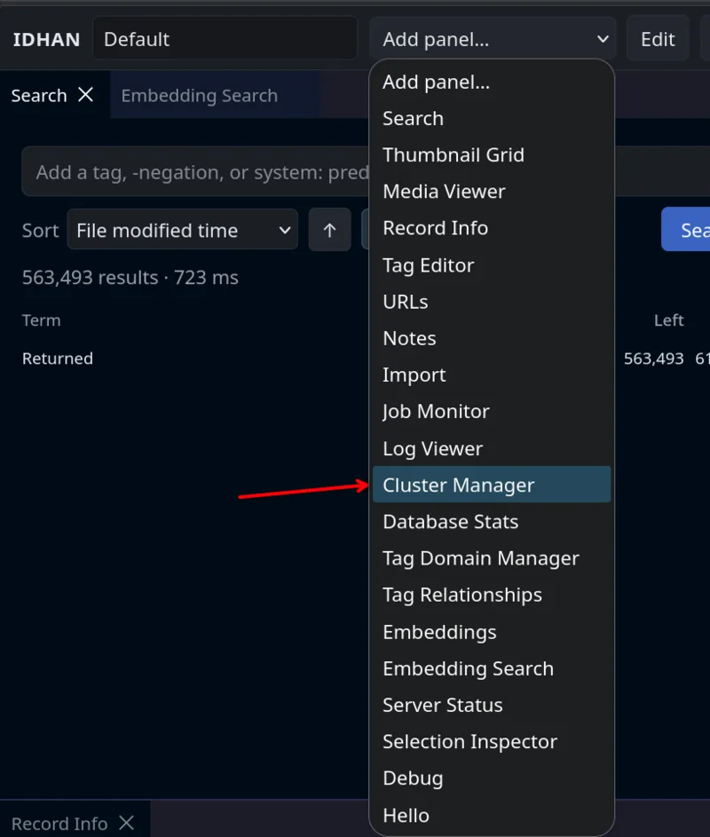
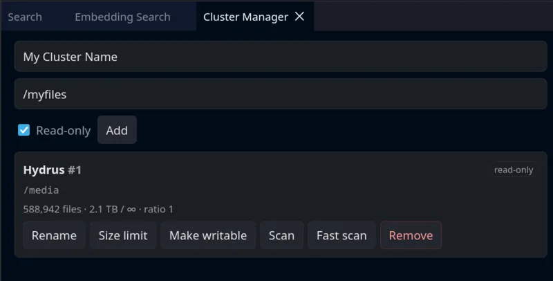

# Getting started

## Config

For a Docker deployment, start with the [Docker guide](docker.md). Its Compose example configures the database and
persistent thumbnail storage. For a native deployment, configure the paths and database connection below.

Note: Each config will be listed as `[group] name`, this can either be set via an ENV variable `IDHAN_GROUP_NAME` or in
one of the toml files

Example:

```toml
[group]
name = value
```

### Thumbnails

The main thing to set up here will be where IDHAN will place thumbnails it's generated via one of the thumbnail
generators. To do so you'll want to set a path for `[thumbnails] path`

### Postgres

The main values to set here will be
(all are in group `[database]`)

- `host` - The host or ip of the pg database
- `user` - The user to attempt to sign in with
- `password` - the password to try to use
- `database` - The database name

### Postgres Setup (Non-Docker Compose)

Create the PostgreSQL database and user before starting IDHAN;
see [Database initialization](database-initialization.md).
IDHAN applies schema migrations on startup. Keep the existing schema when restarting or upgrading.
Deleting the schema is only appropriate for an intentional database reset: it removes database records and metadata.
Dropping tables alone does not reset all schema objects, such as functions.

## Creating your first cluster

###### If you are coming from Hydrus, This is just a file path set in the 'database' management stuff.

A cluster is a file location that IDHAN can read files from and write files to. IDHAN expects files in a cluster to be
named by their hash with an extension. A cluster marked **readonly** will never have files added, moved, or renamed by
IDHAN — it will only index what is already there. Readonly clusters may have no identity marker; registration and
startup recovery do not create one. Any existing marker must still be valid and match the registered identity.
Changing a cluster to writable initializes a missing marker and requires filesystem write permission.

**New clusters default to readonly.** This is intentional: it gives you a chance to verify the scan results before
allowing IDHAN to make any changes to your files. If you are pointing IDHAN at an existing collection (e.g. migrating
from Hydrus or another tool), keep readonly enabled until you are confident the scan looks correct.

To create a cluster, start the server and open the WebUI at `http://<host>:16609/` (use HTTPS if you enabled TLS).
When no API keys exist, visit `/generate_api_key` on that server, save the returned `key`, and enter it in the WebUI.
Once a key exists, that endpoint returns 404; use an existing key to manage additional keys.

Start by adding the 'Cluster Manager' panel from the 'Add panel...' menu



Add a cluster with a unique name and its storage path. For new uploads, mark at least one cluster **writable**;
imports cannot store files when all clusters are readonly.

With the Docker guide's Compose example, use a container path such as `/media/clusters/main`, which is persisted
under the host directory mounted at `/media`. Use container paths in the WebUI, and keep cluster paths inside a
persistent mount. Mounting a directory alone does not register it as a cluster. A readonly cluster's directory must
already exist; a writable cluster can create its directory during registration.



### Expected file structure

IDHAN organises files inside a cluster using the file's SHA-256 hash. Files are placed in a two-character prefix
subdirectory derived from the first two hex characters of the hash:

```
cluster_root/
  f{hex[0:2]}/
    {full_sha256}.{ext}
```

For example, a JPEG whose hash starts with `ab` would be at:

```
cluster_root/fab/ab3f7c....jpg
```

Readonly scans require files to follow this layout. Writable scans can move hash-named files from a different
immediate subdirectory into the correct hash directory. Scans inspect files one directory level below the cluster
root; they do not import arbitrary filenames or recursively traverse a collection. Files directly in the root,
the `bad/` directory, and files ending in `.thumbnail` are skipped. Validation failures are reported in the scan
results; failed files are not moved into `bad/`.

> **Note:** Thumbnails are **not** stored in clusters. They are written to a separate path configured via
> `[thumbnails] path` in the config file (default: `./thumbnails`), using the layout
> `t{hex[0:2]}/{sha256}.thumbnail`.

The Docker image overrides the thumbnail path to `/thumbnails`. The Docker guide's Compose example sets it to
`/media/thumbnails` so thumbnails persist in the media mount.

## Scanning a cluster

Open the cluster's **Scan** menu to choose scan options. Enable **Adopt Orphans** to register hash-named files that
have no existing database record. The filename and directory requirements above still apply. Leave this option off
when you only want to check files already registered in the database.

Hash verification is a separate option and defaults to off. Enable it to check that each file's contents match the
SHA-256 in its filename. Review the scan results for validation failures; adopting orphans does not bypass validation.

## Where did my imported files go?

Currently there is no proper workflow system for imported files. That will be coming later. But for now you can view
EVERY file by simply doing an empty search with no tags. You can then sort by imported time.

## Swagger Docs

If you are interested in using the API endpoints directly. There is a swagger docs built and available at the `/api`
endpoint. If you don't know what this means then it's probably not for you.

## Getting hydrui/hyweb to work

> Note that you must give the path to the hydrus 3rd-party program as `<ip>:<port>/hyapi`.

If you are not self hosting either, you'll need to setup either a proxy to provide https, or add in your own self-signed
keys to IDHAN for it to function properly.

### Self-signed keys

For local use, IDHAN can create and retain a self-signed certificate automatically. Enable TLS and set
`self_sign_tls = true`; on first startup, IDHAN writes the configured certificate and key paths if **both** are
absent. It never overwrites either file. The generated certificate covers `localhost`, `127.0.0.1`, and `::1` and
must still be trusted by the browser or client.

```toml
[host]
use_tls = true
self_sign_tls = true
```

Alternatively, create the certificate yourself:

You can run `openssl req -x509 -newkey rsa:4096 -keyout server.key -out server.crt -days 365 -nodes` in a directory that
you're happy with for the keys to be in, and then provide IDHAN with the information to use the keys
Set the following in one of your config files for IDHAN

```toml
[host]
use_tls = true
server_cert_path = "/home/whatever/yourpath/server.crt"
server_key_path = "/home/whatever/yourpath/server.key"

# if either are set to "" then it will just not listen on it

ipv4_listen = "127.0.0.1" # localhost only
# or
ipv4_listen = "0.0.0.0" # all

ipv6_listen = "::1" #localhost
# or
ipv6_listen = "::" # any
```
